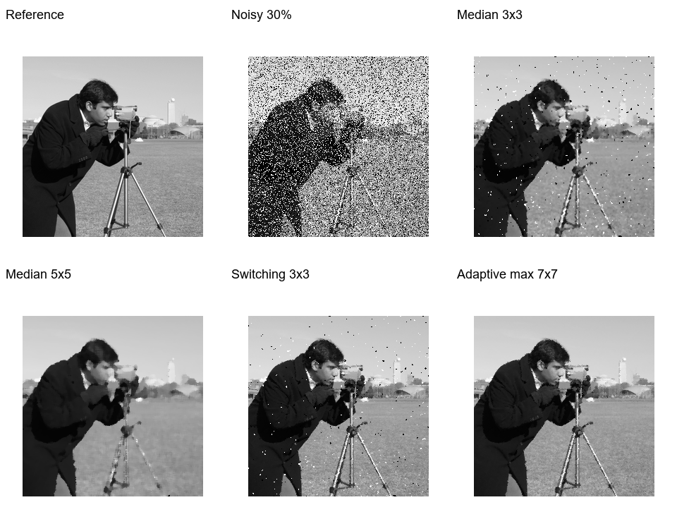

# 椒盐噪声图像的中值滤波去噪与对比

《图像处理与分析》课程项目。用固定 3×3 中值滤波作为基础版本，实现经典自适应中值滤波，并用固定 5×5 和端点开关滤波作对照。不是新算法，也未使用训练模型。

## 运行

Python 3.12，CPU 即可。建议使用虚拟环境。

```bash
python -m pip install -r requirements.txt
python test_correctness.py
python run_experiment.py
python denoise.py input.png output.png --method adaptive7
```

支持 `median3`、`median5`、`switching3`、`adaptive7`。输入为彩色图时会转换为灰度；本项目不评估颜色保真。原始示例图已包含在 data/，实验运行无需联网。

## 数据与实验

四张 scikit-image v0.19.3 示例图：camera、coins、moon、page。先保持比例缩小到长边 256，再加 5%、15%、30% 椒盐噪声。三个种子为 2026、2027、2028。各方法使用相同含噪输入。来源见 [data/SOURCES.md](data/SOURCES.md)。

36 个含噪样本、每个样本 5 个评价对象，共 180 条记录。PSNR 用全图 MSE；SSIM 使用 7×7 均匀窗口、样本协方差、有效内部区域、data_range=255。均值是每张图和每个种子等权平均。

## 实测结果

| 密度 | 固定 3×3 PSNR / SSIM | 自适应 PSNR / SSIM | 开关 3×3 PSNR / SSIM |
| --- | --- | --- | --- |
| 5% | 29.57 / 0.8640 | 33.41 / 0.9465 | 40.01 / 0.9920 |
| 15% | 27.52 / 0.8413 | 32.23 / 0.9403 | 32.73 / 0.9675 |
| 30% | 21.61 / 0.6714 | 29.80 / 0.9129 | 24.16 / 0.8218 |

低噪声下端点开关滤波更好；自适应方法在 30% 条件下更稳，但耗时更多。仅四张缩小灰度图，不据此推断真实噪声下的效果。



## 代码修改与报告

- `baseline_v1.py`：保留的固定 3×3 起始程序。
- `src/filters.py`：增加自适应窗口、两阶段判断，以及开关对照方法。
- `denoise.py`：统一单图命令行入口。
- `run_experiment.py`：固定种子、批量处理、计时、CSV 和图片导出。
- `src/metrics.py`：显式实现 PSNR 与 SSIM。
- `test_correctness.py`：独立逐像素参考实现与边界、指标检查。
- [report.md](report.md)：完整报告，包含老师要求的任务、数据、代码修改、结果对比和仓库地址。
- `docs/code_changes.patch`：起始入口到最终入口的差异；算法细节在 src/filters.py。
- `results/metrics.csv`：全部逐样本数值；`results/summary.json`：汇总、运行环境、文件 SHA-256。

基础版本提交：[`fd311c0`](https://github.com/jinjinjimai32-gif/JinJin/commit/fd311c0eeb2b0c8ddff1757f066b369d4c59bd8e)。后续提交包含完整实验实现。

自适应中值为经典方法的课程实现，参数预设为最大 7×7，没有在独立验证集上搜索参数。运行时间仅供本机粗略比较，不是严谨性能基准。第三方示例图片的来源说明与权利信息见数据文档。
