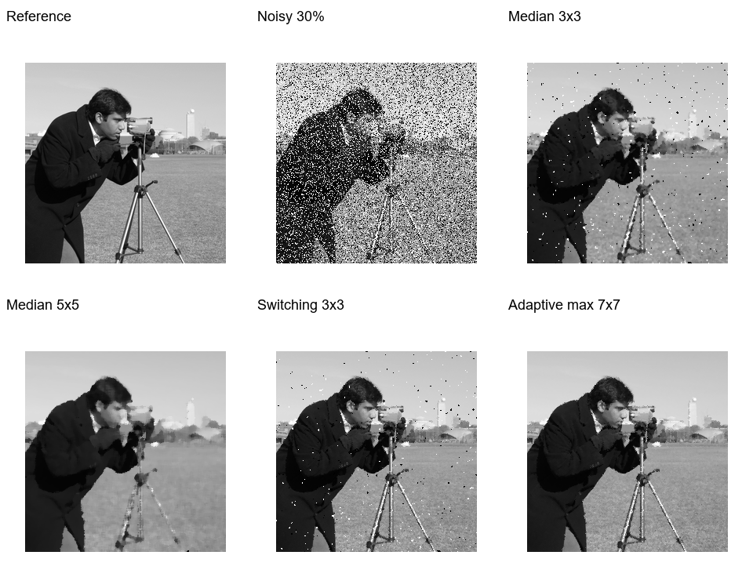
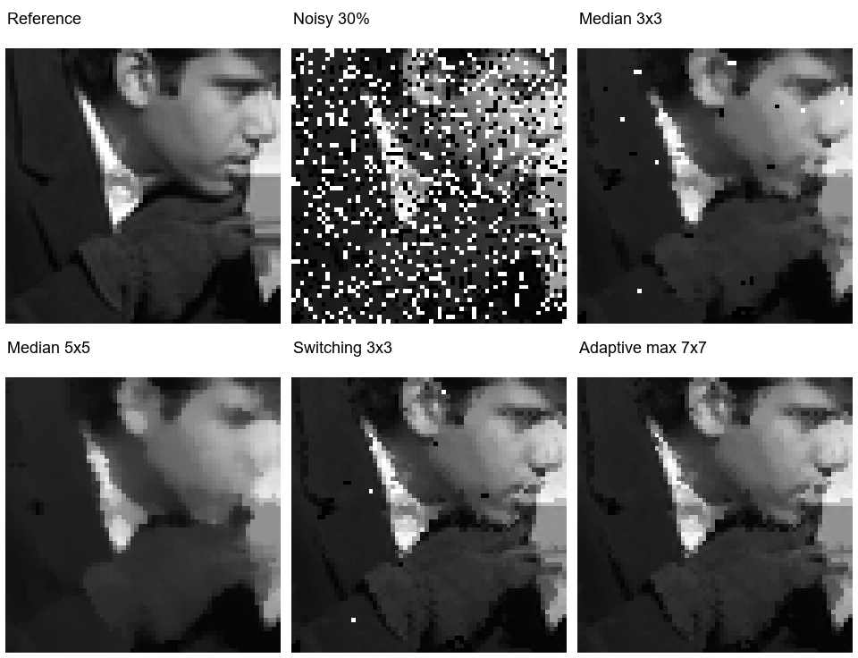
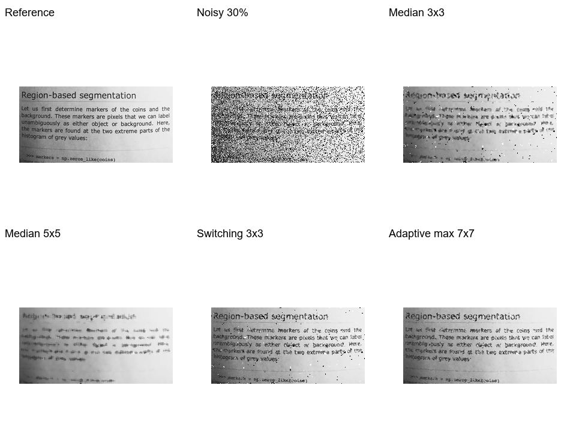
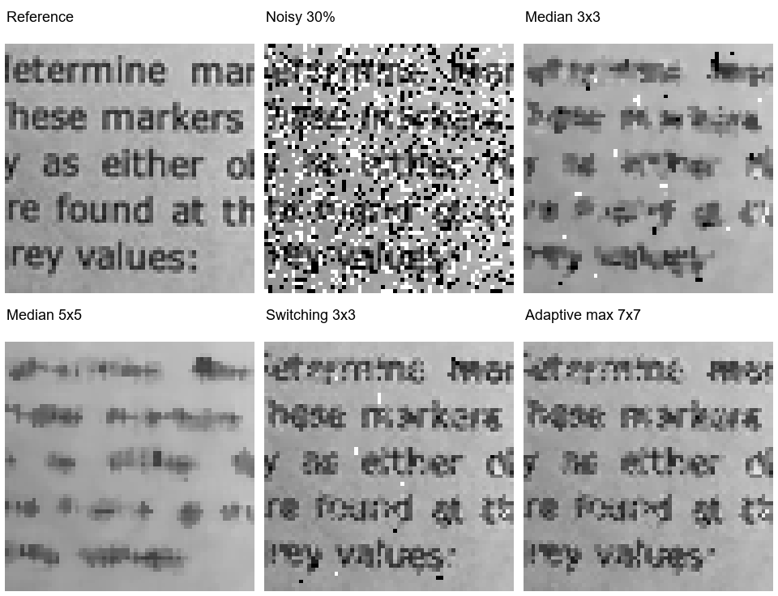

# 椒盐噪声图像的中值滤波去噪与对比

## 1 项目地址与任务描述

GitHub：https://github.com/jinjinjimai32-gif/JinJin

本项目处理灰度图像中的椒盐噪声。基础版本使用固定 3×3 中值滤波，在噪声较少时能够去掉不少孤立亮点和暗点，但噪声增多后会留下斑点；直接扩大窗口又容易把边缘和细线抹平。因此，在基础程序上加入自适应窗口和像素判断，并比较去噪效果与运行时间。

实验使用四张公开示例图像，人为加入已知比例的椒盐噪声，再与干净图像比较。30% 噪声条件下，自适应方法的平均 PSNR 为 29.80 dB，比基础版本高 8.18 dB；但在 5% 和 15% 噪声下，简单的开关中值滤波平均指标更高。这说明应按噪声条件选择方法。

## 2 数据描述

原始数据取自 scikit-image v0.19.3 的 data 目录，文件名为 camera.png、coins.png、moon.png 和 page.png。它们分别包含人物及相机、硬币轮廓、月面灰度纹理和印刷文字，便于观察不同结构在滤波后的变化。数据来源与文件校验值保存在 data/SOURCES.md 和 results/summary.json 中。[1]

| 图像 | 原始尺寸 宽×高 | 实验尺寸 宽×高 | 观察内容 |
| --- | --- | --- | --- |
| camera | 512×512 | 256×256 | 人物轮廓与灰度过渡 |
| coins | 384×303 | 256×202 | 硬币边缘和表面纹理 |
| moon | 512×512 | 256×256 | 平缓区域与月面细节 |
| page | 384×191 | 256×127 | 文字笔画和背景 |

读取后统一为 8 位灰度图，灰度范围为 0～255。加噪前使用 LANCZOS 将长边缩小到 256 像素，保持宽高比，不放大小图。处理后的干净图作为参考图像。这里没有学习模型，因此不划分训练集和测试集；四张图都用于对比实验，不能据此代表所有图像。

## 3 方法与代码修改

### 3.1 固定窗口基础版本

baseline_v1.py 保留起始版本。程序把输入转成灰度图，对边界做对称填充，再取每个 3×3 邻域的中值。输出仅取决于当前邻域，不读取已更新的输出像素。基础版本已单独提交，便于与后续修改核对。

基础版本提交：fd311c0eeb2b0c8ddff1757f066b369d4c59bd8e

### 3.2 自适应中值滤波

改进版本实现经典的两阶段自适应中值滤波，并未提出新的算法。自适应中值滤波的相关研究见文献 [3]。对当前像素先使用 3×3 窗口，计算最小值 zmin、最大值 zmax 和中值 zmed。若 zmin < zmed < zmax，说明中值不是该窗口的极值，进入像素判断；否则把窗口扩大到 5×5、7×7。达到上限仍不满足条件时，使用当前窗口的中值。

像素判断使用原输入值 zxy。若 zmin < zxy < zmax，就保留该值；否则用 zmed 替换。这样可以减少对正常像素的修改，也能在局部噪声密集时扩大邻域。所有比较都直接使用大小关系，避免 uint8 相减时出现无符号溢出。窗口始终从同一张含噪图像提取，不做原地迭代。

### 3.3 修改位置与对照方法

| 文件 | 修改内容 | 作用 |
| --- | --- | --- |
| src/filters.py | 增加 adaptive_median 和未完成像素掩码 | 按局部统计决定窗口大小 |
| src/filters.py | 保留 fixed_median，增加 switching_median | 比较扩大窗口与保留正常像素的作用 |
| denoise.py | 增加方法选择参数 | 同一入口处理用户图片 |
| run_experiment.py | 增加固定种子、批量实验、CSV 和对照图 | 让结果可重算、可核对 |
| src/metrics.py | 增加 PSNR 与 SSIM | 用数值量化图像变化 |
| test_correctness.py | 与逐像素参考实现比较 | 检查边界、极值和窗口判断 |

对照包含固定 5×5 中值滤波，以及仅把灰度为 0 或 255 的像素替换为 3×3 中值的开关滤波。开关滤波利用了本实验噪声恰好落在两个端点的条件；真实图像中的纯黑、纯白区域也可能被误判。自适应方法同样依赖局部极值判断，也存在误改正常极值像素的可能。

## 4 实验设置与数值结果

噪声密度设为 5%、15% 和 30%。每个像素生成一次均匀随机数 u：u < p/2 时置 0，p/2 ≤ u < p 时置 255，其余保留。每个条件使用 2026、2027、2028 三个随机种子。同一图像、密度和种子下，各方法共用完全相同的含噪图。

共有 4 张图 × 3 个密度 × 3 个种子，即 36 个含噪样本。含噪输入加上四种滤波方法，共得到 180 条评价记录。p 是抽样概率，不保证有限图像中被选中的比例恰好等于 p；原来就是 0 或 255 的像素被选中后也可能不改变。CSV 同时记录抽样比例和实际改变比例。

PSNR 以完整图像的均方误差计算：PSNR = 10 log10(255²/MSE)。SSIM 使用 7×7 均匀窗口、样本方差和协方差，C1=(0.01×255)²、C2=(0.03×255)²，仅平均完整窗口的内部区域。两项指标均为越大越好。[2]

| 噪声密度 | 方法 | 平均 PSNR dB | 平均 SSIM |
| --- | --- | --- | --- |
| 5% | 含噪图像 | 18.28 | 0.3959 |
| 5% | 固定中值 3×3 | 29.57 | 0.8640 |
| 5% | 固定中值 5×5 | 26.53 | 0.7586 |
| 5% | 开关中值 3×3 | 40.01 | 0.9920 |
| 5% | 自适应中值 最大 7×7 | 33.41 | 0.9465 |
| 15% | 含噪图像 | 13.45 | 0.1799 |
| 15% | 固定中值 3×3 | 27.52 | 0.8413 |
| 15% | 固定中值 5×5 | 26.24 | 0.7532 |
| 15% | 开关中值 3×3 | 32.73 | 0.9675 |
| 15% | 自适应中值 最大 7×7 | 32.23 | 0.9403 |
| 30% | 含噪图像 | 10.40 | 0.0990 |
| 30% | 固定中值 3×3 | 21.61 | 0.6714 |
| 30% | 固定中值 5×5 | 25.52 | 0.7414 |
| 30% | 开关中值 3×3 | 24.16 | 0.8218 |
| 30% | 自适应中值 最大 7×7 | 29.80 | 0.9129 |

每个表格单元为四张图、三个种子的 12 次等权平均，不是把全部像素拼接后再计算。30% 噪声下，自适应方法相对固定 3×3 的 PSNR 提高 8.18 dB，SSIM 提高 0.2415；相对固定 5×5，分别提高 4.28 dB 和 0.1715。低噪声时开关滤波更好，不能只展示 30% 条件。

## 5 图像结果对比

图中依次为参考图、含噪图、固定 3×3、固定 5×5、开关 3×3 和自适应中值结果。固定 3×3 后仍有孤立亮点和暗点。固定 5×5 的斑点少一些，但脸部灰度变化和衣服边缘更平滑。自适应方法在这张图上减少了残留斑点，也保留了较清楚的轮廓。放大图使用相同位置的 64×64 区域，不做额外增强。

## 5 图像结果对比 续

文字图更能反映滤波损失。固定 5×5 会让细笔画变粗或粘连，自适应结果虽然减少了黑白噪点，但部分笔画仍有缺损。这里没有运行 OCR，不能把视觉上更清楚直接解释成识别率提高。仓库也保存了 coins 和 moon 的对应图片，便于核对其他内容。

## 6 结果分析与复现

### 6.1 不同图像与运行代价

| 图像 | 固定 3×3 | 固定 5×5 | 开关 3×3 | 自适应 7×7 |
| --- | --- | --- | --- | --- |
| camera | 22.01 | 24.35 | 24.38 | 28.93 |
| coins | 21.56 | 24.28 | 24.07 | 27.71 |
| moon | 24.83 | 35.29 | 26.73 | 40.30 |
| page | 18.06 | 18.16 | 21.45 | 22.25 |

表中为 30% 噪声下三个种子的平均 PSNR。moon 的改善比文字图明显，说明平缓灰度区域更容易通过邻域恢复。page 的自适应结果只有 22.25 dB，文字细节仍是困难部分。汇总 PSNR 的离散程度也包含不同图像内容的差异，不能当成单一图像上的随机误差。

本次环境为 Windows 11、Python 3.12.14、NumPy 2.3.5、Pillow 13.0.0，处理器标识见 summary.json。30% 噪声下，固定 3×3、固定 5×5、开关 3×3 和自适应方法的平均滤波时间分别为 5.13、13.06、5.27 和 72.95 ms。计时只包含滤波调用，未计读图、指标计算和保存；没有做专门的预热与重复性能基准，因此这些时间仅供本机粗略比较。

### 6.2 可以得到什么结论

这次修改解决了基础版本在较高椒盐噪声下残留较多斑点的问题，但效果提升伴随更多计算。低噪声时，扩大窗口和局部极值判断未必有利，简单开关方法已经能取得较好结果。实验只覆盖四张缩小后的灰度图和人工端点噪声，没有验证彩色图像、真实传感器噪声或高斯噪声，也没有在独立数据上调参。后续可先扩大测试图像，再比较其他噪声类型，不能直接把本次结论推广过去。

### 6.3 运行与核对

安装：python -m pip install -r requirements.txt
实验：python run_experiment.py
检查：python test_correctness.py
单图：python denoise.py input.png output.png --method adaptive7

原图随代码提供，实验过程不联网、不下载模型。metrics.csv 保存逐项指标，summary.json 保存汇总、数据校验值与环境。程序检查包括与独立逐像素参考实现的对照，以及常量图、孤立脉冲、PSNR 和 SSIM 恒等情况；4 项检查全部通过。

## 参考资料

[1] scikit-image 示例数据说明与原始数据目录。
https://scikit-image.org/docs/stable/api/skimage.data.html
https://github.com/scikit-image/scikit-image/tree/v0.19.3/skimage/data

[2] Wang Z, Bovik A C, Sheikh H R, Simoncelli E P. Image Quality Assessment: From Error Visibility to Structural Similarity. IEEE Transactions on Image Processing, 2004, 13(4): 600–612. https://doi.org/10.1109/TIP.2003.819861

[3] Hwang H, Haddad R A. Adaptive Median Filters: New Algorithms and Results. IEEE Transactions on Image Processing, 1995, 4(4): 499–502. https://doi.org/10.1109/83.370679
